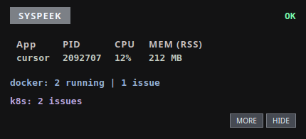

<div align="center">

# Debug Overlay

### A tiny, always-on-top HUD for the app you're focused on — CPU, RAM, and Docker/Kubernetes status at a glance.

[](#compatibility)
[](#install)
[](#install)
[](LICENSE)

[Install](#install) · [Compatibility](#compatibility) · [Use](#use) · [GNOME / KDE setup](#gnome--kde-setup) · [Docker & Kubernetes](#docker--kubernetes) · [Troubleshooting](#troubleshooting)

<sub>Repository: <strong>Syspeek</strong></sub>

<br />



</div>

---

No more digging through `top`. Debug Overlay follows the window you're using and
shows that app's CPU and RAM, plus optional Docker/Kubernetes health, in a small
panel that stays on top and out of your way.

## Install

Pick **one** of the two ways below. Most people want the first.

### Option 1 — Build from your distro's Qt 6 (recommended)

Install the build tools, then build and install:

| Distribution | Command |
| --- | --- |
| Ubuntu / Debian / Mint / Kali | `sudo apt install build-essential cmake qt6-base-dev` |
| Fedora | `sudo dnf install gcc-c++ cmake qt6-qtbase-devel` |
| RHEL 9 / CentOS Stream 9 / Rocky / Alma | `sudo dnf install epel-release && sudo dnf config-manager --set-enabled crb && sudo dnf install gcc-c++ cmake qt6-qtbase-devel` |
| Arch / CachyOS / Manjaro | `sudo pacman -S --needed base-devel cmake qt6-base` |
| openSUSE Tumbleweed | `sudo zypper install gcc-c++ cmake qt6-base-devel` |
| Alpine | `sudo apk add build-base cmake qt6-qtbase-dev` |

> **Two gotchas:** on **Ubuntu 22.04 / Debian 12-or-older-era Qt 6.2**, also add
> `libgl-dev`. On the **RHEL 9 family**, Qt 6 comes from **EPEL**, so enable it
> first (see the command above). Distros that don't ship Qt 6 at all (RHEL 8,
> Ubuntu 20.04, Debian 11, openSUSE Leap, Amazon Linux 2023) should use Option 2.

Then:

```bash
git clone https://github.com/codeafridi/Syspeek.git
cd Syspeek
cmake -S cpp -B cpp/build
cmake --build cpp/build -j"$(nproc)"
bash cpp/install.sh
```

That's it — it's running now and will start automatically on every login.

### Option 2 — Portable bundle (no Qt required)

A single self-contained tarball with Qt 6 and its dependencies bundled, so it runs
on almost any Linux **without installing Qt**. Requires Docker only to *build* it:

```bash
git clone https://github.com/codeafridi/Syspeek.git
cd Syspeek
bash cpp/packaging/build_portable.sh          # writes dist/debug-overlay-portable.tar.gz

mkdir -p ~/.local/opt/debug-overlay
tar xzf dist/debug-overlay-portable.tar.gz -C ~/.local/opt/debug-overlay
~/.local/opt/debug-overlay/run.sh             # run it
```

Use this on distros with no Qt 6 packages (openSUSE Leap, Amazon Linux, RHEL 8,
older Ubuntu/Debian). See [Compatibility](#compatibility) for the exact coverage.

### Other commands

- Prefer no systemd service? `bash cpp/install.sh --no-systemd` (uses XDG autostart).
- Remove it: `bash cpp/install.sh --uninstall`.
- Try it without installing anything: `./cpp/build/debug_overlay_hud`.

> On **GNOME** or **KDE** you also need a one-time focus bridge — see
> [GNOME / KDE setup](#gnome--kde-setup). Everything else works out of the box.

## Compatibility

Tested on real containers (build + all tests + launch). "Qt 6 pkg" = built against
the distro's own Qt; "Portable" = the Option 2 bundle, with no Qt installed.

| Distribution | Qt 6 pkg | Portable | Notes |
| --- | :---: | :---: | --- |
| Ubuntu 26.04 / 24.04 | ✅ | ✅ | |
| Ubuntu 22.04 | ✅ | ✅ | add `libgl-dev` |
| Debian 13 / 12 | ✅ | ✅ | |
| Kali Rolling | ✅ | ✅ | |
| Fedora 42 / 44 | ✅ | ✅ | |
| RHEL 9 / Rocky 9 / Alma 9 / CentOS Stream 9 | ✅ | ✅ | Qt 6 via **EPEL** |
| openSUSE Tumbleweed | ✅ | ✅ | |
| openSUSE Leap 15.6 | ➖ | ✅ | no Qt 6 in base repos |
| Arch / CachyOS / Manjaro | ✅ | ✅ | |
| Amazon Linux 2023 | ➖ | ✅ | no Qt 6 in base repos |
| Alpine (musl) | ✅ | ➖ | build with apk (musl) |
| Ubuntu 20.04 / Debian 11 | ➖ | ➖ | glibc too old for the bundle; no Qt 6 pkg |
| RHEL 8 / Rocky 8 / Alma 8 | ➖ | ➖ | no Qt 6 in EPEL 8 |

**Portable bundle floor:** glibc ≥ 2.34 (distros released ~2021 onward) and the
x86-64 architecture. Untested but expected to work: Gentoo, Void, NixOS,
SteamOS/Bazzite (glibc ≥ 2.34).

## Use

- **Drag** the panel anywhere (grab it, including the buttons).
- **`MORE` / `LESS`** — open/close the diagnosis panel.
- **`HIDE` / `SHOW`** — collapse to a single line or expand.
- **Click `docker:` or `k8s:`** — expand that badge's details.
- **`Ctrl+C`** in the terminal — quit.

## GNOME / KDE setup

Focus detection works on GNOME, KDE, Sway, niri, and X11 out of the box. On
**GNOME** and **KDE** the focused app is shared through a small bridge you install
once:

**GNOME** (then log out and back in):

```bash
bash install_gnome_extension.sh
```

**KDE Plasma (Wayland):**

```bash
bash cpp/install_kde_focus.sh
```

On **Sway / niri / Hyprland / X11**, install the matching tool (`swaymsg` /
`niri` / `hyprctl` / `xdotool`) and you're done. Other Wayland compositors run
fine but show `no-focus`.

## Docker & Kubernetes

Both are optional. If the tool isn't installed or reachable, the overlay shows a
status instead of failing.

- **Docker** — shows running count and flags unhealthy, restarting, and recently
  exited containers.
- **Kubernetes** — flags problem pods (`CrashLoopBackOff`, image-pull failures,
  `OOMKilled`) and deployments with too few ready replicas, using your current
  `kubectl` context.

## Advanced (optional)

Thresholds and polling intervals are configurable in
`~/.config/debug-overlay/config.ini`; sensible defaults are used if it's absent.

Handy environment variables:

- `DEBUG_OVERLAY_PROBE=1 ./debug-overlay` — print the detected focus provider and
  focused PID, then exit.
- `DEBUG_OVERLAY_LOG=/tmp/overlay.log` — log status to a file.

## Troubleshooting

**The app column shows `--` / `no-focus`.** Focus detection isn't available yet.

1. Run the probe to see which provider was chosen:

   ```bash
   DEBUG_OVERLAY_PROBE=1 ./cpp/build/debug_overlay_hud
   ```

2. Set up the bridge for your desktop (see
   [GNOME / KDE setup](#gnome--kde-setup)) and, on GNOME, **log out and back in**.

**It builds but won't start.** Check the platform plugin:

```bash
QT_DEBUG_PLUGINS=1 ./cpp/build/debug_overlay_hud 2>&1 | tail
```

## License

[MIT](LICENSE).
